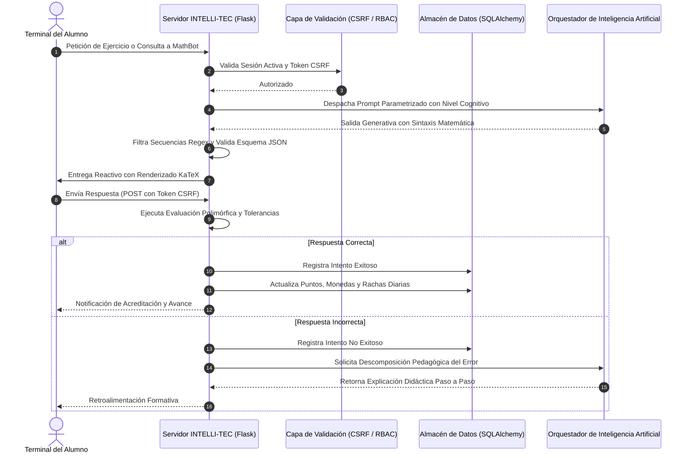

# DOSSIER TÉCNICO DE PROPIEDAD INTELECTUAL Y PATENTES: INTELLI-TEC LMS
### Marco Jurídico Mexicano: IMPI (LFPPI) e INDAUTOR (LFDA)
### Titular de Derechos: Instituto Tecnológico Superior de Teziutlán (ITST)

---

## 1. Marco Legal de Protección de Software en México: IMPI vs INDAUTOR

Para la protección integral de la plataforma **INTELLI-TEC** a nombre del **Instituto Tecnológico Superior de Teziutlán**, el marco jurídico mexicano contempla dos instituciones fundamentales y complementarias:

### A. INDAUTOR (Instituto Nacional del Derecho de Autor) — Registro de Obra
- **Ley Aplicable**: Ley Federal del Derecho de Autor (LFDA), Artículos 13 fracción XI y 101 al 114.
- **Materia de Protección**: El código fuente, código objeto, estructura de base de datos, manuales técnicos y de usuario como una obra del intelecto humano tipificada como **Programa de Computación (Software)**.
- **Titularidad**: El Instituto Tecnológico Superior de Teziutlán como titular de los derechos patrimoniales (obra por encargo / relación laboral institucional), reconociendo los derechos morales de los autores desarrolladores.
- **Efecto Legal**: Otorga el Certificado de Registro de Obra con presunción de autoría y titularidad oponible ante terceros.
- **Trámite**: Formato oficial RPDA-01 ante la Dirección de Registro Público del INDAUTOR.

### B. IMPI (Instituto Mexicano de la Propiedad Industrial) — Patente CII y Registro de Marca
- **Ley Aplicable**: Ley Federal de Protección a la Propiedad Industrial (LFPPI), Artículos 47 fracción IV, 48, 49, 163 al 167 y 213.
- **Criterio de Patentabilidad de Software (CII - Computer-Implemented Inventions)**: Conforme al Artículo 47 fracción IV de la LFPPI, los programas de computación por sí mismos no se consideran invenciones. Sin embargo, las invenciones que incorporan software son patentables cuando se formulan como un **método y sistema computacional** que interactúa con elementos físicos, resuelve un problema técnico concreto y produce un efecto técnico tangible que supera la interacción básica entre hardware y software.
- **Vías de Registro ante el IMPI para el ITST**:
  1. **Solicitud de Patente de Invención / Modelo de Utilidad**: Bajo la figura de invención implementada en computadora, protegiendo el método adaptativo de evaluación y orquestación pedagógica con IA.
  2. **Registro de Marca**: Protección del signo distintivo **INTELLI-TEC** en las Clases 42 (Servicios tecnológicos y software) y 41 (Servicios de educación y capacitación) de la Clasificación Internacional de Niza.
  3. **Régimen de Secreto Industrial**: Protección legal de prompts, ponderaciones heurísticas y parámetros internos conforme a los Artículos 163 a 167 de la LFPPI.

---

## 2. Memoria Técnica Descriptiva de la Invención

Documento descriptivo elaborado bajo las directrices de presentación de solicitudes de patente ante el Instituto Mexicano de la Propiedad Industrial.

### 2.1. Título de la Invención
> **SISTEMA Y MÉTODO COMPUTACIONAL DISTRIBUIDO PARA LA TUTORÍA PEDAGÓGICA Y EVALUACIÓN ADAPTATIVA MEDIANTE ORQUESTACIÓN DE MODELOS DE LENGUAJE, PARSEO SINTÁCTICO DE FÓRMULAS MATEMÁTICAS, GAMIFICACIÓN POR COHORTES Y AUDITORÍA INMUTABLE DE EVENTOS.**

### 2.2. Solicitante y Titular
> **Instituto Tecnológico Superior de Teziutlán (ITST)**

### 2.3. Campo Técnico de la Invención
La invención pertenece al campo de los sistemas de procesamiento de datos para la educación interactiva (LMS / EdTech), específicamente a plataformas que combinan interfaces web seguras, orquestación de modelos de lenguaje basados en transformadores (LLMs), validación de sintaxis matemática LaTeX/KaTeX, mecanismos de gamificación reactiva temporal y trazabilidad inmutable de eventos académicos.

### 2.4. Antecedentes y Estado de la Técnica
Las plataformas educativas tradicionales presentan limitaciones críticas:
1. **Evaluación Estática sin Descomposición Causal**: Los sistemas convencionales corrigen mediante comparación binaria (correcto/incorrecto) sin explicar al estudiante la causa de su error ni guiarlo a través de un procedimiento correctivo secuencial.
2. **Inestabilidad Estructural de Salidas en Modelos LLM**: La integración directa de modelos generativos produce con frecuencia caracteres de escape no compatibles o JSON malformado que provocan fallos catastróficos en el renderizador del navegador.
3. **Falta de Trazabilidad Forense de Operaciones Académicas**: Los servidores web estándar registran accesos genéricos, pero carecen de esquemas de auditoría a nivel de entidad que almacenen el estado previo y posterior de una modificación en cursos o calificaciones.

### 2.5. Problema Técnico que Resuelve la Invención
1. Desarrollar un conducto de transformación y validación sintáctica que garantice que las fórmulas algebraicas en formato LaTeX generadas por una inteligencia artificial no corrompan las estructuras JSON transmitidas al cliente.
2. Diseñar un mecanismo de tolerancia diferencial y evaluación difusa capaz de comparar respuestas continuas y de múltiples términos de manera automatizada.
3. Crear un esquema de contingencia de alta disponibilidad que alterne transparentemente entre modelos de lenguaje de respaldo ante saturaciones o restricciones de cuota.
4. Establecer un control riguroso de avance secuencial que impida al estudiante saltar lecciones sin haber acreditado las anteriores.

### 2.6. Descripción Detallada del Sistema

La invención se compone de cuatro subsistemas cooperativos:

#### Subsistema 1: Módulo Orquestador de Inteligencia Artificial y Filtro Sintáctico
- **Control de Contingencia y Reintentos**: Ante una petición pedagógica, el módulo consulta un modelo primario optimizado (`gemini-2.5-flash`); ante errores de cuota, latencia o indisponibilidad, conmuta de forma automática a modelos de respaldo (`gemini-1.5-flash`) mediante un algoritmo de retroceso exponencial.
- **Normalización de Caracteres de Escape para LaTeX**: Emplea un filtro de expresiones regulares que reemplaza barras invertidas aisladas generadas en fórmulas matemáticas algebraicas, permitiendo su correcta deserialización en JSON y su renderizado fluido a través del motor KaTeX en el cliente.
- **Motor de Evaluación Polimórfico**: Evalúa seis tipos de reactivos matemáticos aplicando tolerancias matemáticas flotantes $|u - c| < 0.001$ para respuestas de cálculo, y segmentación por delimitadores para respuestas de ordenamiento y texto complementario.

#### Subsistema 2: Control de Secuencia Pedagógica y Aislamiento Criptográfico
- **Identificadores Criptográficos de Curso**: Cada curso genera un código alfanumérico único (`MTC-[A-Z0-9]{8}`) mediante el generador de entropía criptográfica del sistema operativo, impidiendo la predicción de identificadores secuenciales.
- **Validación Ordinal de Desbloqueo**: Las lecciones permanecen bloqueadas hasta que el motor constata en base de datos que la totalidad de lecciones con índice ordinal menor han sido completadas satisfactoriamente por el estudiante.

#### Subsistema 3: Motor de Gamificación Reactiva Basado en Ventanas Temporales
- **Algoritmo de Racha de Estudio**: El método calcula la diferencia en días calendario entre la fecha actual y la fecha del último registro de actividad. Si la diferencia es de un día, incrementa la racha; si es mayor a un día, la reinicia a la unidad; y si la diferencia es cero, preserva el valor sin alteraciones, asegurando equidad pedagógica.
- **Transaccionalidad en Economía Virtual**: La entrega de puntos de experiencia (XP) y el débito de incentivos visuales se ejecuta bajo aislamiento transaccional estricto con restricciones de unicidad para evitar duplicaciones o consumos concurrentes inválidos.

#### Subsistema 4: Subsistema de Trazabilidad y Certificación Automatizada
- **Auditoría Inmutable**: Todo evento administrativo sensible registra el identificador de usuario, la dirección IP de origen, el sello de tiempo y el estado serializado del objeto modificado.
- **Motor de Certificados Vectoriales**: Tras verificar en tiempo real que el progreso acumulado de lecciones acreditadas alcanza el 100%, genera de manera programática un archivo PDF estructurado con sellos institucionales.

### 2.7. Diagrama de Flujo Técnico del Sistema

---

## 3. Pliego de Reivindicaciones Técnicas (Para el IMPI)

### Reivindicación 1 (Independiente — Método):
> **1. Un método computacional para la tutoría pedagógica y evaluación adaptativa implementado en una arquitectura cliente-servidor distribuida, que comprende:**
> - a) recibir, a través de una interfaz gráfica segura, una solicitud de contenido o resolución de ejercicio educativo;
> - b) estructurar un prompt semántico con parámetros de nivel cognitivo, tema matemático y tipo de reactivo seleccionado de un conjunto que incluye opción múltiple, cálculo numérico con margen de tolerancia flotante y ordenamiento de pasos;
> - c) consultar un servicio de inteligencia artificial generativa mediante un orquestador tolerante a fallos que conmuta automáticamente entre modelos de respaldo;
> - d) filtrar y transformar la respuesta generada mediante sustitución programática de secuencias de escape de barras invertidas para preservar fórmulas algebraicas en sintaxis LaTeX y asegurar la compatibilidad de deserialización en estructuras JSON;
> - e) evaluar la respuesta del usuario mediante un procesador diferencial que compara valores continuos dentro de un margen predefinido o coincidencias normalizadas con delimitadores múltiples;
> - f) persistir el intento en una base de datos relacional y actualizar atómicamente un registro de racha temporal de días consecutivos y saldo de incentivos del usuario; y
> - g) condicionar el acceso a lecciones posteriores a la acreditación obligatoria de todas las lecciones precedentes según su índice ordinal.

### Reivindicación 2 (Dependiente):
> **2. El método de conformidad con la reivindicación 1, caracterizado porque** la actualización de la racha temporal comprende calcular la diferencia de días calendario reales entre la fecha de sesión actual y la fecha de última actividad registrada, donde un incremento ocurre únicamente ante una diferencia de exactamente un día calendario.

### Reivindicación 3 (Dependiente):
> **3. El método de conformidad con la reivindicación 1, caracterizado porque** ante una evaluación no aprobatoria, el sistema solicita de forma reactiva al modelo generativo una explicación causal que desglosa el procedimiento de resolución sin revelar de forma explícita la respuesta final al alumno.

### Reivindicación 4 (Independiente — Sistema):
> **4. Un sistema informático para la gestión y tutoría de contenidos académicos, caracterizado porque comprende:**
> - uno o más procesadores;
> - una memoria acoplada a dichos procesadores que almacena instrucciones de programa ejecutables que, al ser procesadas, ejecutan el método de las reivindicaciones 1 a 3; y
> - un módulo de auditoría inmutable configurado para registrar en un repositorio persistente la dirección IP de origen, la identidad del usuario y los estados previo y posterior de cualquier mutación de entidad académica.

---

## 4. Guía Institucional para el Registro de Obra ante INDAUTOR

Procedimiento oficial para registrar el código fuente a nombre del **Instituto Tecnológico Superior de Teziutlán**:

### 4.1. Formato Requerido
- **Formato Oficial**: Formato `RPDA-01` (Solicitud de Registro de Obra).
- **Rama**: Programa de Computación (Software).

### 4.2. Documentación a Presentar
1. **Formato RPDA-01 Requisitado**:
   - Titular de los derechos patrimoniales: **Instituto Tecnológico Superior de Teziutlán** (con indicación de RFC institucional y datos del representante legal o director general).
   - Datos del autor o autores desarrolladores con cesión o encargo de obra.
   - Título de la obra: `INTELLI-TEC LMS: Plataforma de Gestión Académica y Tutoría con Inteligencia Artificial`.
2. **Comprobante Oficial de Pago de Derechos**:
   - Pago conforme a la Ley Federal de Derechos (Clave de referencia de la Secretaría de Cultura / INDAUTOR).
3. **Ejemplar de la Obra (Soporte Material)**:
   - Impresión o soporte digital en disco óptico cerrado que contenga las primeras 10 y últimas 10 hojas del código fuente de los módulos esenciales, o el repositorio íntegro en medio digital.
   - Manual técnico y de instalación impreso o digital (utilizando el contenido del archivo `README.md`).

---

## 5. Registro de Signo Distintivo (Marca) ante el IMPI

Lineamientos para salvaguardar la denominación oficial de la plataforma:

1. **Denominación**: `INTELLI-TEC` o `INTELLI-TEC LMS`.
2. **Titular**: **Instituto Tecnológico Superior de Teziutlán**.
3. **Clases de la Clasificación Internacional de Niza**:
   - **Clase 42**: *Servicios de software como servicio (SaaS), plataformas tecnológicas en la nube para la administración del aprendizaje, desarrollo y programación de software para la educación.*
   - **Clase 41**: *Servicios educativos, provisión de cursos en línea, tutoría académica e instrucción mediante plataformas digitales.*
4. **Plataforma**: Portal oficial del IMPI (*Tu Cuenta Tu Marca* - `marcanet.impi.gob.mx`).

---

## 6. Política de Secreto Industrial (LFPPI Artículos 163 al 167)

Para salvaguardar los algoritmos, esquemas de bases de datos y la ingeniería de instrucciones (prompts) de INTELLI-TEC:
1. Las variables de configuración de entornos y claves privadas se resguardan fuera de repositorios de acceso abierto a través del archivo `.env`.
2. Todo participante que intervenga en el mantenimiento o desarrollo del sistema debe suscribir una cláusula o convenio institucional de estricta confidencialidad.
3. Se asienta la leyenda legal institucional:
   > *"INFORMACIÓN INSTITUCIONAL CONFIDENCIAL Y SECRETO INDUSTRIAL — Propiedad exclusiva del Instituto Tecnológico Superior de Teziutlán. Protegido por los Artículos 163 a 167 de la Ley Federal de Protección a la Propiedad Industrial de los Estados Unidos Mexicanos."*
