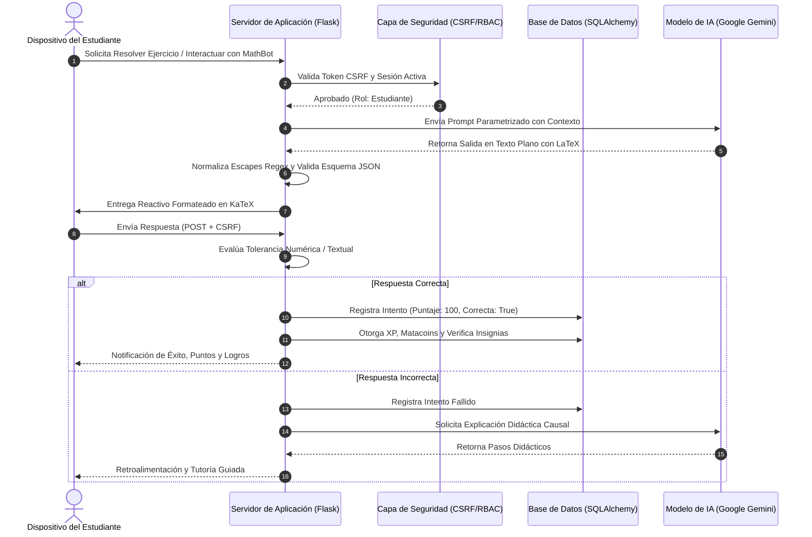

# DOSSIER TÉCNICO DE PROPIEDAD INTELECTUAL Y PATENTES: MATATUCAS LMS
### Marco Jurídico Mexicano: IMPI (LFPPI) e INDAUTOR (LFDA)

---

## 🏛️ 1. Marco Legal de Protección de Software en México: IMPI vs INDAUTOR

Una de las dudas más frecuentes en el ecosistema tecnológico mexicano es cómo "patentar" un código de software. En el marco jurídico de los Estados Unidos Mexicanos existen dos instituciones complementarias:

### A. INDAUTOR (Instituto Nacional del Derecho de Autor) — *Vía Principal para el Código Fuente*
- **Ley Aplicable**: Ley Federal del Derecho de Autor (LFDA), Arts. 13 fracción XI, 101 al 114.
- **Qué protege**: El **código fuente**, **código objeto**, la **arquitectura lógica**, los **manuales de usuario** y la **expresión literal del software** como una obra intelectual protegida por derechos de autor.
- **Efecto legal**: Otorga el **Registro de Obra de Programa de Computación**, otorgando derechos morales inalienables y derechos patrimoniales exclusivos durante toda la vida del autor y 100 años después de su muerte.
- **Costo del trámite**: Tarifa gubernamental baja (aprox. \$350 - \$450 MXN) y resolución ágil (15 a 30 días hábiles).

### B. IMPI (Instituto Mexicano de la Propiedad Industrial) — *Invención Implementada en Computadora (CII)*
- **Ley Aplicable**: Ley Federal de Protección a la Propiedad Industrial (LFPPI), Arts. 47 fracción IV, 48, 49, 163-167.
- **Restricción legal**: El Art. 47 fracción IV de la LFPPI establece que los programas de computación *por sí mismos (en abstracto)* **no son considerados invenciones patentables**.
- **Vía de Patentabilidad (CII - Computer-Implemented Inventions)**: Para que un desarrollo de software pueda patentarse ante el IMPI, debe redactarse como un **"Método y Sistema implementado en computadora"** que resuelva un problema técnico concreto en el mundo tangible o produzca un efecto técnico novedoso y reproducible que vaya más allá de la interacción estándar del hardware.
- **Otras vías ante el IMPI**:
  1. **Registro de Marca**: Protección del nombre comercial "MATATUCAS", su isotipo, imagotipo y lema comercial (Clases 42 y 41 de la Clasificación de Niza).
  2. **Secreto Industrial**: Protección contra revelación no autorizada de algoritmos propietarios, ponderaciones y prompts de optimización de IA (Arts. 163 a 167 LFPPI).

---

## 🔬 2. Memoria Técnica Descriptiva de la Invención (Para Solicitud ante el IMPI)

A continuación se presenta la memoria técnica con el formato y rigor exigido por el IMPI para solicitudes de patente de invención / modelo de utilidad implementado en computadora.

### 2.1. Título de la Invención
> **SISTEMA Y MÉTODO COMPUTACIONAL DISTRIBUIDO PARA LA TUTORÍA PEDAGÓGICA Y EVALUACIÓN ADAPTATIVA MEDIANTE ORQUESTACIÓN DE MODELOS DE LENGUAJE, PARSEO SINTÁCTICO DE FÓRMULAS MATEMÁTICAS, GAMIFICACIÓN POR COHORTES Y AUDITORÍA INMUTABLE DE EVENTOS.**

### 2.2. Campo Técnico de la Invención
La presente invención se ubica en el campo técnico de los sistemas de procesamiento de datos para la educación (LMS / EdTech), específicamente en sistemas que combinan interfaces de usuario interactivas, modelos generativos de inteligencia artificial basados en transformadores (LLMs), validadores de sintaxis matemática rigurosa (LaTeX/KaTeX), mecanismos de gamificación reactiva y registros de auditoría estructurados para trazabilidad académica.

### 2.3. Antecedentes y Estado del Arte
Los sistemas tradicionales de gestión del aprendizaje (Moodle, Blackboard, Canvas) operan como repositorios estáticos de contenidos. Presentan severas limitaciones técnicas:
1. **Rigidez en la evaluación**: Las preguntas son predefinidas y estáticas; cuando un estudiante falla un ejercicio numérico o algebraico, el sistema se limita a señalar el error sin ofrecer una descomposición causal ni retroalimentación adaptativa paso a paso.
2. **Alucinaciones e inconsistencias en la IA generativa**: La integración ingenua de modelos LLM en plataformas educativas frecuentemente devuelve salidas con errores de sintaxis matemática o formatos JSON inválidos que rompen el árbol DOM en el cliente.
3. **Ausencia de auditoría granular**: Los registros estándar de servidores web no permiten rastrear de forma contextual e inmutable las alteraciones de estado pedagógico, calificaciones y accesos de seguridad a nivel de entidad.

### 2.4. Problema Técnico que Resuelve la Invención
1. La falta de un mecanismo tolerante a fallos que garantice que las respuestas de un modelo de inteligencia artificial se apeguen estrictamente a estructuras JSON tipificadas y expresiones algebraicas válidas en LaTeX.
2. La vulnerabilidad de auto-completado indebido y manipulación de progreso en sesiones de aprendizaje que combinan video externo (YouTube API) y ejercicios parametrizados.
3. La desconexión entre el rendimiento cognitivo del alumno y los estímulos de refuerzo positivo (gamificación por rachas temporales y economías virtuales cerradas).

### 2.5. Descripción Detallada de los Componentes de la Invención

La invención se estructura en cuatro módulos técnicos interdependientes:

#### Módulo A: Motor Orquestador de IA con Parseo Sintáctico y Fallback Dinámico (`ServicioIA`)
- **Algoritmo de Reintento y Escalado**: El sistema implementa un ciclo de reintentos exponenciales con selección de modelos de respaldo (`gemini-2.5-flash` a `gemini-1.5-flash`). Si el modelo primario experimenta latencia o falta de disponibilidad, el despachador conmuta automáticamente al modelo de contingencia.
- **Filtro de Expresiones Regulares para LaTeX y JSON**: Mediante expresiones regulares adaptativas `re.sub(r'\\(?!["\\/bfnrtu])', r'\\\\', texto)`, el sistema neutraliza escapes no válidos de barras invertidas generadas en fórmulas matemáticas LaTeX, garantizando que el serializador `json.loads` nunca sufra excepciones catastróficas.
- **Tipificación Polimórfica de Reactivos**: Clasificación algorítmica de preguntas en seis modalidades (`opcion_multiple`, `verdadero_falso`, `numerico`, `completar_texto`, `ordenar_pasos`, `respuesta_corta`), cada una con su propia heurística de evaluación tolerante (`_evaluar_respuesta_ejercicio` con umbral flotante $|u - c| < 0.001$ para valores continuos y comparación difusa con delimitadores `;` y `|`).

#### Módulo B: Subsistema de Aislamiento y Secuencia de Aprendizaje
- **Verificación Criptográfica de Código Único**: Cada curso genera un identificador alfanumérico seguro `MTC-[A-Z0-9]{8}` mediante entropía criptográfica (`secrets.choice`), impidiendo ataques de fuerza bruta o adivinación de identificadores enteros secuenciales.
- **Bloqueo por Secuencia Pedagógica**: El acceso a lecciones avanzadas está restringido algorítmicamente mediante consultas que comparan el conjunto de lecciones completadas con el orden ordinal (`orden < leccion.orden`), impidiendo avances fraudulentos.

#### Módulo C: Motor de Gamificación Reactiva y Economía Virtual
- **Algoritmo de Racha Temporal por Ventana de Calendario**: El método `actualizar_racha_login` calcula la diferencia de días calendario reales entre la fecha actual y la fecha de última interacción. Si $\Delta t = 1$, la racha incrementa en $+1$; si $\Delta t > 1$, la racha se reinicia; si $\Delta t = 0$, se mantiene inalterada, evitando duplicación de beneficios en el mismo día.
- **Consumo Atómico de Moneda Virtual (Matacoins)**: Las transacciones de compra en la tienda de avatares y marcos operan bajo aislamiento transaccional (`bd.session`), descontando el saldo del estudiante y vinculando el artículo mediante una restricción de unicidad (`unique_inv`) para evitar carreras críticas (*race conditions*).

#### Módulo D: Módulo de Auditoría Inmutable y Generación de Certificaciones
- **Trazabilidad Forense**: Toda mutación de entidades pedagógicas (publicación, retiro de alumnos, despublicación, eliminación) registra la dirección IP remota, el identificador del usuario actor y el estado previo/posterior serializado en JSON.
- **Generación Vectorial de Certificados**: Mapeo directo de la tasa de lecciones completadas frente a las totales. Al alcanzar el umbral del 100%, el motor ReportLab genera un documento PDF firmado y sellado con metadatos no editables.

### 2.6. Diagrama de Arquitectura y Flujo Técnico

---

## 📑 3. Pliego de Reivindicaciones Técnicas (Reclamaciones de Patente)

El pliego de reivindicaciones define el alcance legal exclusivo de la invención protegida ante el IMPI:

### Reivindicación 1 (Independiente — Método):
> **1. Un método computacional para la tutoría pedagógica y evaluación adaptativa implementado en una arquitectura cliente-servidor, que comprende:**
> - a) recibir, a través de una interfaz gráfica segura, una solicitud de contenido o resolución de ejercicio educativo;
> - b) construir un prompt semántico estructurado que inyecta parámetros de nivel cognitivo, tema matemático y tipo de reactivo seleccionado de un conjunto que incluye opción múltiple, cálculo numérico con tolerancia flotante, y ordenamiento de pasos;
> - c) consultar un servicio de inteligencia artificial generativa mediante un orquestador con tolerancia a fallos que conmuta automáticamente entre modelos de respaldo;
> - d) filtrar y transformar la respuesta recibida mediante sustitución programática de secuencias de escape de barras invertidas para preservar fórmulas algebraicas en sintaxis LaTeX y asegurar compatibilidad de deserialización JSON;
> - e) evaluar la respuesta del usuario mediante un procesador diferencial que compara valores continuos dentro de un margen predefinido $|u - c| < \epsilon$ o coincidencias normalizadas con delimitadores múltiples;
> - f) persistir el intento en una base de datos relacional y actualizar atómicamente un registro de racha temporal de días consecutivos y saldo de moneda virtual del usuario; y
> - g) condicionar la habilitación de lecciones subsiguientes a la verificación obligatoria de completitud de todas las lecciones precedentes de acuerdo con su índice ordinal.

### Reivindicación 2 (Dependiente):
> **2. El método de conformidad con la reivindicación 1, caracterizado porque** la actualización de la racha temporal comprende calcular la diferencia en días calendario $\Delta t = t_{\text{actual}} - t_{\text{último\_login}}$, donde si $\Delta t = 1$ se incrementa la racha, si $\Delta t > 1$ se reinicia a 1, y si $\Delta t = 0$ se mantiene inalterada.

### Reivindicación 3 (Dependiente):
> **3. El método de conformidad con la reivindicación 1, caracterizado porque** ante un fallo de evaluación, el sistema genera de forma reactiva una solicitud secundaria a la inteligencia artificial que analiza la respuesta errónea del estudiante frente a la solución esperada y retorna una descomposición en pasos correctivos sin exponer la respuesta directa.

### Reivindicación 4 (Independiente — Sistema):
> **4. Un sistema informático para la gestión y tutoría de cursos académicos, que comprende:**
> - uno o más procesadores;
> - una memoria acoplada a dichos procesadores que almacena instrucciones ejecutables que, al ser procesadas, ejecutan el método de las reivindicaciones 1 a 3; y
> - un módulo de auditoría inmutable configurado para interceptar y registrar en un almacén persistente la dirección IP de origen, el identificador del usuario y el estado de la entidad antes y después de cada mutación crítica.

---

## 📝 4. Guía Paso a Paso para el Registro de Obra ante INDAUTOR

Esta es la vía legal inmediata, económica y de mayor certeza jurídica para proteger el código fuente de Matatucas en México.

### 4.1. Formato Requerido
- **Formato Oficial**: `RPDA-01` (Solicitud de Registro de Obra).
- **Rama**: Programa de Computación (Software).

### 4.2. Documentación a Integrar
1. **Formato RPDA-01 debidamente llenado**:
   - Datos del autor(es) (nombre, CURP, RFC, domicilio).
   - Título de la obra: `MATATUCAS LMS: Plataforma Inteligente de Gestión Académica y Tutoría con IA`.
   - Síntesis de la obra (resumen de 1 párrafo).
2. **Comprobante de pago de derechos**:
   - Hoja de ayuda e-Cinco para pago en ventanilla bancaria o banca en línea (Clave de referencia / Concepto: Registro de Obra de Programa de Computación).
3. **Anexo Técnico del Código (Soporte Material)**:
   - Copia del código fuente representativo (las primeras 10 y últimas 10 hojas del código fuente, o el código completo en soporte digital USB / CD-R cerrado).
   - Manual de usuario o guía de instalación impresa/digital (se puede usar el `README.md` formateado en PDF).

### 4.3. Presentación
- **Presencial**: Oficinas centrales de INDAUTOR en Puebla 143, Col. Roma Norte, Cuauhtémoc, Ciudad de México, o en las representaciones de la Secretaría de Cultura en los estados.
- **En línea**: Vía la plataforma **INDAUTOR en Línea (SIDER)** con e.firma (SAT).

---

## 🏷️ 5. Guía para el Registro de Marca "MATATUCAS" ante el IMPI

Para proteger comercialmente el nombre de la plataforma y evitar plagio de marca:

1. **Plataforma**: Portal de Servicios Electrónicos del IMPI (Tu Cuenta Tu Marca - `marcanet.impi.gob.mx`).
2. **Clasificación de Niza**:
   - **Clase 42 (Servicios Tecnológicos y Software)**: *"Servicios de software como servicio (SaaS), plataformas en la nube para la gestión del aprendizaje, programación informática, diseño y desarrollo de software educativo."*
   - **Clase 41 (Educación y Capacitación)**: *"Servicios educativos, impartición de cursos en línea, tutoría académica y provisión de ejercicios didácticos interactivos."*
3. **Requisitos**:
   - Nombre de la marca: `MATATUCAS` o `MATATUCAS LMS`.
   - Logotipo en archivo JPG (si es mixta).
   - Pago de tarifa oficial ante el IMPI (aprox. \$3,126 MXN por clase, con vigencia de 10 años renovables).
   - e.firma del titular.

---

## 🔐 6. Protección de Secreto Industrial (LFPPI Arts. 163-167)

Para los algoritmos propietarios, ponderaciones de gamificación y prompts internos de ingeniería de IA:
1. Mantener el archivo `.env` fuera de cualquier repositorio público (garantizado en `.gitignore`).
2. Implementar convenios de confidencialidad y cesión de derechos de propiedad intelectual (NDA) con cualquier desarrollador o docente que colabore en el proyecto.
3. Marcar los documentos de diseño y algoritmos internos con la leyenda legal:
   > *"INFORMACIÓN CONFIDENCIAL Y SECRETO INDUSTRIAL — Propiedad exclusiva de Emilio Monsoul / Equipo Matatucas. Protegido por los Artículos 163 a 167 de la Ley Federal de Protección a la Propiedad Industrial de México."*
